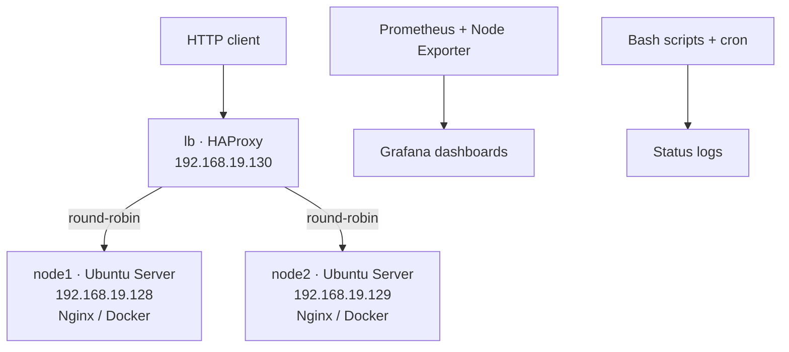

# Linux Infrastructure Lab — Load Balancing, Containers & Monitoring

**Final Degree Project (TFG) · BSc in Computer Engineering · Universitat Oberta de Catalunya (UOC) · June 2026**

A hands-on Linux infrastructure lab built with three Ubuntu Server virtual machines. It combines HTTP load balancing, containerized web services, infrastructure monitoring, and basic systems automation.

> **Project status:** The original laboratory implementation was completed and validated in June 2026. **Repository publication is in progress:** the original configuration files, scripts, screenshots, and final report have not yet been imported here. This README documents the implemented project, but the current repository is not yet a reproducible deployment.

## Architecture

The virtual machines run under **VMware Workstation**, using a Host-Only network for communication between nodes and a NAT interface for internet access.

| Virtual machine | Lab IP | Role |
| --- | --- | --- |
| `node1` | `192.168.19.128` | Web backend: Nginx, later also containerized Nginx |
| `node2` | `192.168.19.129` | Second web backend: Nginx, later also containerized Nginx |
| `lb` | `192.168.19.130` | HAProxy entry point, HTTP round-robin distribution |

These are private, local-lab addresses; the service is **not** publicly hosted.

## Technologies

- **Systems and networking:** Ubuntu Server, VMware Workstation, Netplan, static IP addressing, Host-Only and NAT networks
- **Web and traffic management:** Nginx, HAProxy, HTTP, round-robin load balancing
- **Containers:** Docker and Docker Compose
- **Observability:** Prometheus, Node Exporter, Grafana
- **Automation:** Bash, cron, status logs

## Extension roadmap

See [Engineering roadmap](docs/ROADMAP.md) for the proposed local HA/Keepalived, Ansible, Terraform, cloud and CI/CD phases. These are **planned extensions**, not part of the completed original TFG.

## Implemented work

1. Created three Ubuntu Server VMs with defined network roles and static IP addressing.
2. Deployed Nginx on both backend servers and HAProxy on the load-balancer VM.
3. Configured and verified HTTP request distribution between both backends using round-robin.
4. Deployed additional Nginx services in Docker containers on port `8080` (alongside the initial host-based Nginx on port `80`) and redirected HAProxy traffic to the containerized backends.
5. Deployed Prometheus, Node Exporter, and Grafana for metrics collection and dashboard visualization, with monitoring services managed using Docker Compose.
6. Created a Bash-based service/container status check scheduled with cron, writing results to log files.

## Validation reported in the final TFG

The final project report records successful checks of:

- Network connectivity between the three virtual machines (`ping`).
- HTTP responses from both web nodes and alternation through HAProxy (`curl`).
- Access to the application through the load balancer from a browser.
- Running Docker web services and load balancing towards port `8080`.
- Available Prometheus metrics and a functioning Grafana dashboard.
- Periodic Bash/cron execution and generated status logs.

**Scope and limitations:** This is a local academic lab, not a production deployment. The two backends improve service resilience, but the **single HAProxy instance remains a single point of failure**. Full load-balancer redundancy, automatic failover, cloud deployment, infrastructure-as-code, and advanced alerting were identified as future improvements; they are **not claimed as implemented here**.

## Repository publication status

The repository currently contains an initial folder scaffold. Before it can serve as a complete reproducible portfolio project, the original files still need to be reviewed and added:

| Directory | Planned original materials |
| --- | --- |
| `configs/` | HAProxy, Nginx, and network configurations |
| `docker/` | Container definitions and related deployment files |
| `monitoring/` | Prometheus/Grafana configuration and Docker Compose files |
| `scripts/` | Bash checks and documented cron configuration |
| `diagrams/` | Architecture diagrams |
| `screenshots/` | Evidence of actual deployment and tests |
| `docs/` | Final report and supplementary technical documentation |

No replacement configuration or invented test output will be presented as an original TFG artifact. Sensitive information will be removed before publishing any source files.

## Potential next steps

- Introduce a second load balancer and Keepalived to avoid the present single point of failure.
- Automate installation and configuration using Ansible.
- Rebuild the infrastructure in AWS using infrastructure-as-code.
- Add TLS, hardening, detailed alerts, and automated checks.

These items are **future extensions**, separate from the completed 2026 project.

## Resumen en español

Trabajo de Fin de Grado realizado en la UOC (junio de 2026): diseño, implementación y validación de una infraestructura Linux virtualizada con **dos servidores web Ubuntu Server**, un balanceador **HAProxy**, servicios Nginx desplegados con **Docker**, monitorización mediante **Prometheus, Node Exporter y Grafana**, y comprobaciones automatizadas con **Bash y cron**.

El laboratorio funcionó en VMware Workstation. La memoria final recoge pruebas de conectividad, balanceo HTTP, contenerización, monitorización y generación automática de logs. El repositorio está en proceso de incorporar los archivos originales. La solución no es una infraestructura de producción ni elimina el punto único de fallo del balanceador.

---

**Author:** [Xavier Arias Bosch](https://github.com/xavierariasbosch6-cmyk)  
**Original project:** *Diseño e implementación de una infraestructura Linux con balanceo de carga, automatización y monitorización*.
